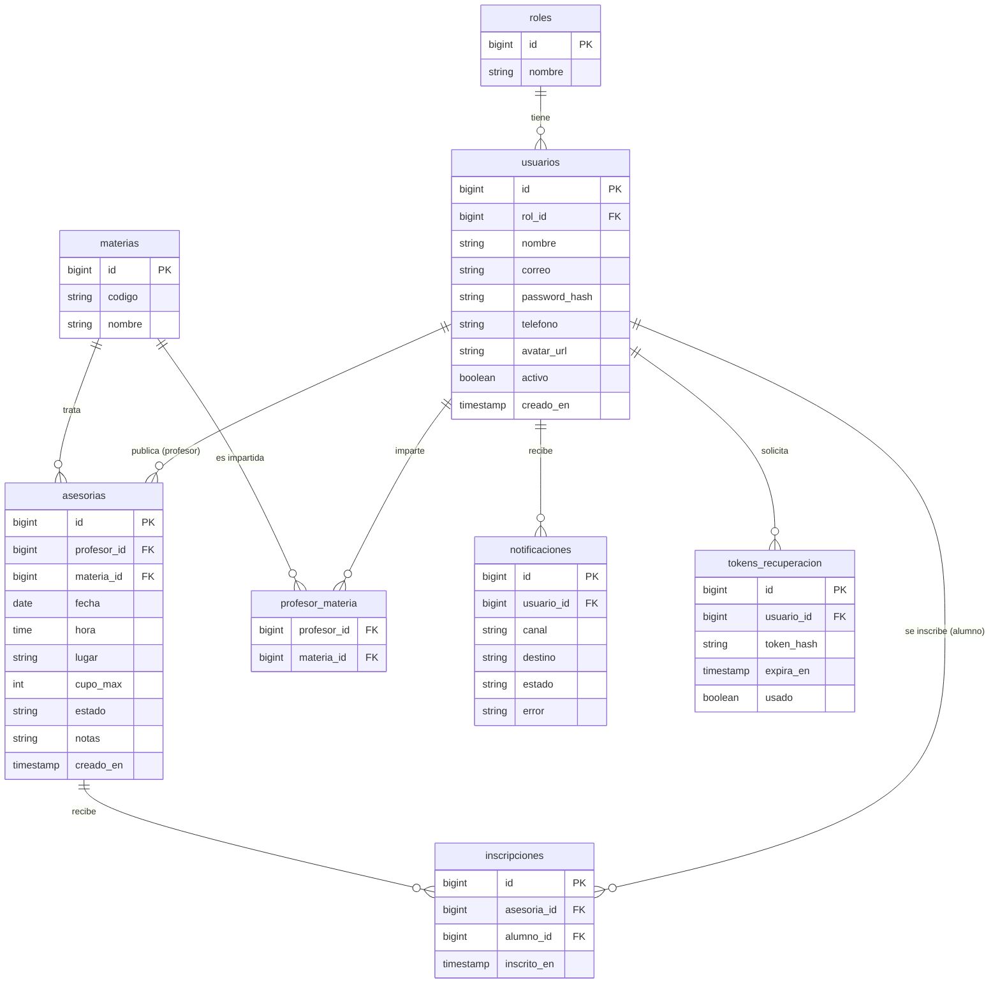

# AyudITO – Plataforma de Asesorías Académicas

Proyecto final de **Programación Web** (Semestre 7).

AyudITO es una página web donde los alumnos encuentran y reservan asesorías con profesores, y los profesores publican y administran sus horarios. También hay un administrador que gestiona usuarios y materias.

## Enlaces

| Qué | Dónde |
|---|---|
| Aplicación | https://ayudito.juarez.top |
| API | https://ayudito.juarez.top/login |
| Tablero del proyecto | https://github.com/users/Isaac051225/projects/2 |
| Diseño en Figma | https://www.figma.com/design/Ibm7b85izfPN6iETO4eqrj/Asesorias?node-id=20-111 |


## Usuarios de prueba

| Rol | Correo | Contraseña |
|---|---|---|
| Administrador | admin@asesorias.com | Admin123! |
| Profesor | aracely.ramirez@asesorias.com | Profesor123! |
| Alumno | maria.hernandez@asesorias.com | Alumno123! |


## Qué puede hacer cada usuario

**Alumno**
- Ver el catálogo de asesorías y filtrar por materia.
- Inscribirse en una asesoría si todavía hay lugar, y cancelar su inscripción.
- Ver sus asesorías en su pantalla de inicio.
- Recibir un aviso (SMS o WhatsApp) al inscribirse o cuando se cancela una asesoría.

**Profesor**
- Crear asesorías: materia, fecha, hora, lugar, cupo y notas.
- Editar las que están activas y cancelarlas.
- Ver quién está inscrito en cada una.

**Administrador**
- Ver, buscar y filtrar usuarios; crear profesores; editar y activar o desactivar cuentas.
- Crear, editar y eliminar materias.
- Ver el registro de todas las notificaciones enviadas y si fallaron.

**Todos** pueden registrarse (como alumnos), iniciar sesión, recuperar su contraseña y editar su perfil.


## Tecnologías

- **Servidor:** Java 21, Spring Boot 4.1, Spring Security con sesión por token (JWT)
- **Página web:** React con Vite
- **Base de datos:** PostgreSQL 17, con cambios controlados por Flyway
- **Avisos:** Twilio (SMS) y correo
- **Pruebas de la API:** Bruno

## Cómo está hecho

El sistema tiene tres partes que se hablan entre sí:

1. **La página (React).** Es lo que ve el usuario. Pide y manda datos al servidor.
2. **El servidor (Spring Boot).** Recibe las peticiones, revisa que la persona haya iniciado sesión y tenga permiso, aplica las reglas (por ejemplo, que no se pase del cupo) y guarda todo en la base de datos.
3. **La base de datos (PostgreSQL).** Guarda usuarios, materias, asesorías, inscripciones y avisos enviados.


Detalles importantes:

- **Sesión y permisos.** Al iniciar sesión el servidor entrega un token. La página lo manda en cada petición y el servidor decide, según el rol (alumno, profesor o administrador), qué puede hacer cada quien.
- **Contraseñas.** Nunca se guardan tal cual: se guardan cifradas.
- **Listas grandes.** Las tablas se piden por páginas, y los filtros y búsquedas los hace el servidor, no el navegador.
- **Validación en dos lados.** Los formularios avisan los errores antes de enviar, y el servidor vuelve a revisar los datos.
- **Avisos.** Al inscribirse o cancelar una asesoría el sistema intenta mandar un SMS o WhatsApp. Si falla, no se rompe nada: queda registrado con el motivo.
- **Cambios en la base de datos.** Se hacen con archivos numerados (Flyway), así todos tienen la misma estructura.
- **Datos de ejemplo.** La primera vez que arranca con la base vacía, el sistema crea usuarios, materias y asesorías de prueba.


## Cómo correrlo en tu computadora

Necesitas Java 21, Node, PostgreSQL y Git.

1. **Descarga el proyecto**
   ```
   git clone https://github.com/DaniielA5/plataforma-asesorias.git
   cd plataforma-asesorias
   ```
2. **Crea la base de datos** llamada `asesorias_db` en PostgreSQL.
3. **Configura el servidor.** Copia `backend/src/main/resources/application.properties.example` como `application.properties` en la misma carpeta y llena tus datos (usuario y contraseña de PostgreSQL, y la clave secreta del token). Este archivo no se sube a GitHub porque tiene datos privados.
4. **Arranca el servidor**
   ```
   cd backend
   .\mvnw.cmd spring-boot:run
   ```
   La primera vez crea las tablas y carga datos de ejemplo (los usuarios de arriba, 12 materias y 15 asesorías).
5. **Arranca la página.** En otra terminal:
   ```
   cd frontend
   npm install
   npm run dev
   ```

6. Abre http://localhost:5173


## Base de datos




## Cómo probar la API

En la carpeta `bruno/` hay una colección para el programa [Bruno](https://www.usebruno.com/). Ábrela, elige el entorno **VPS** (o **Local**) y dale *Run*. Inicia sesión, consulta materias y usuarios, y prueba los errores: sin sesión (401), datos inválidos (400), algo que no existe (404) y sin permiso (403). Contra el VPS pasan las 11 pruebas.


## Equipo

| Integrante | Parte |
|---|---|
| Daniel Alexis Juarez Ramirez | Inicio de sesión y seguridad, asesorías e inscripciones, recuperar contraseña y correos, rediseño de inicio y login, base de datos y respaldo, despliegue en el VPS |
| Isaac Emmanuel Díaz Martinez | Materias, usuarios y perfil (servidor), notificaciones y Twilio, datos de ejemplo, componentes y barra de navegación, formularios de acceso, pantallas de administración, crear y editar asesorías, colección de Bruno, README |


## Capturas

### Pantallas
| Inicio de sesión | Inicio del alumno |
|---|---|
|  |  |

| Usuarios (administrador) | Notificaciones (administrador) |
|---|---|
|  |  |

| Panel del profesor | Crear asesoría |
|---|---|
|  |  |


# Pruebas de la API (Bruno)
