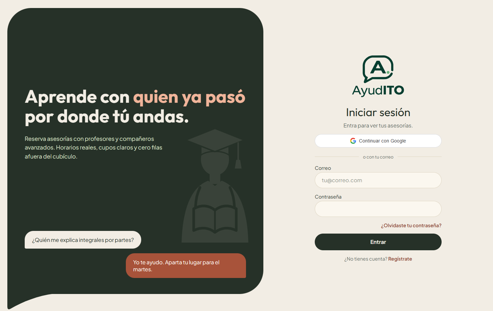
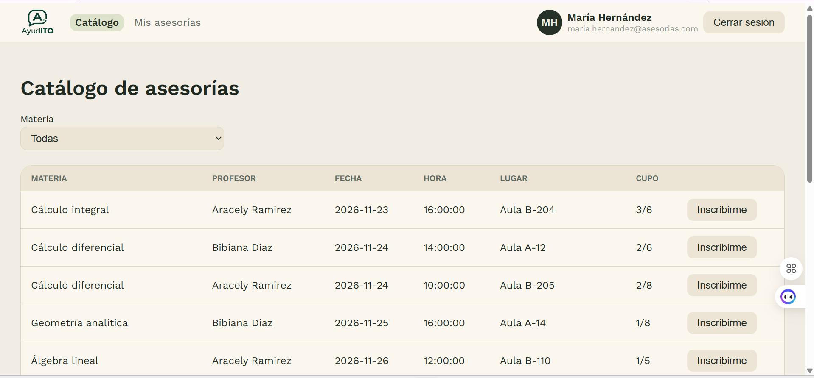
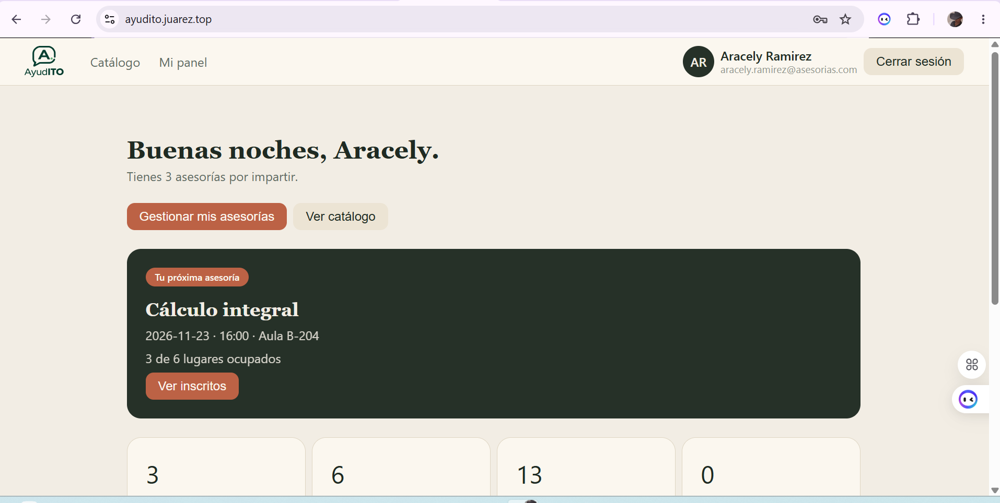
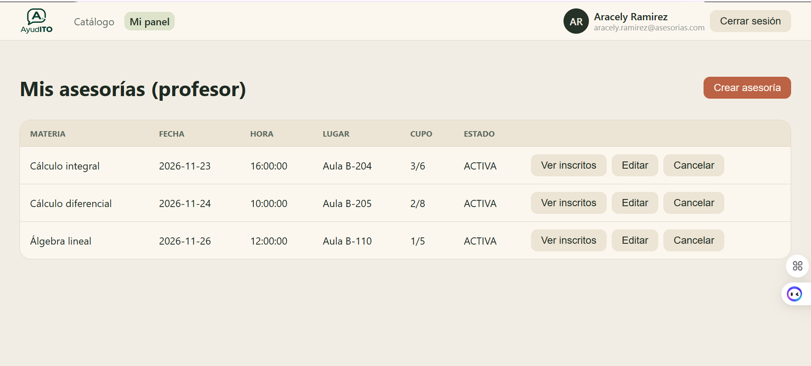
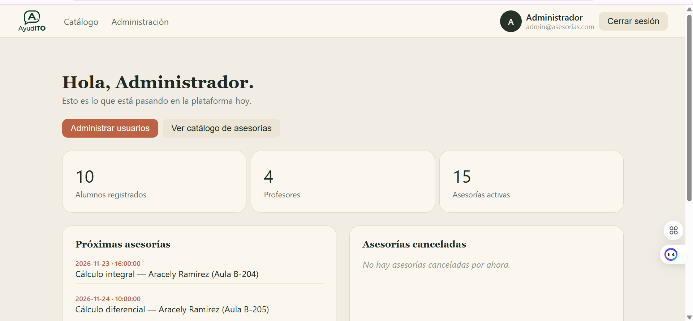
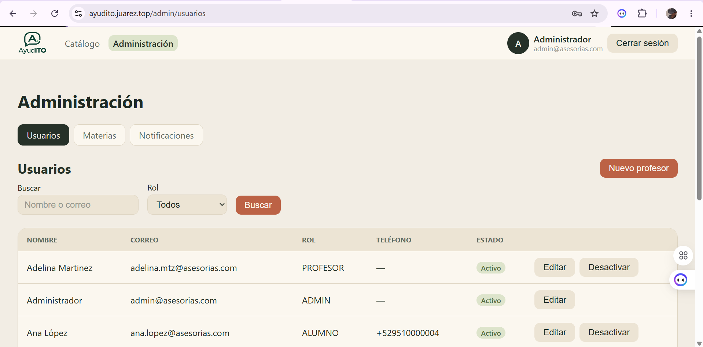
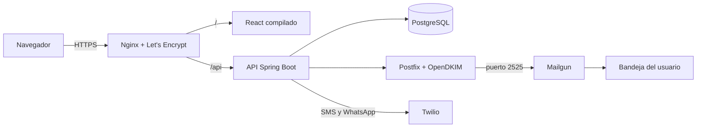
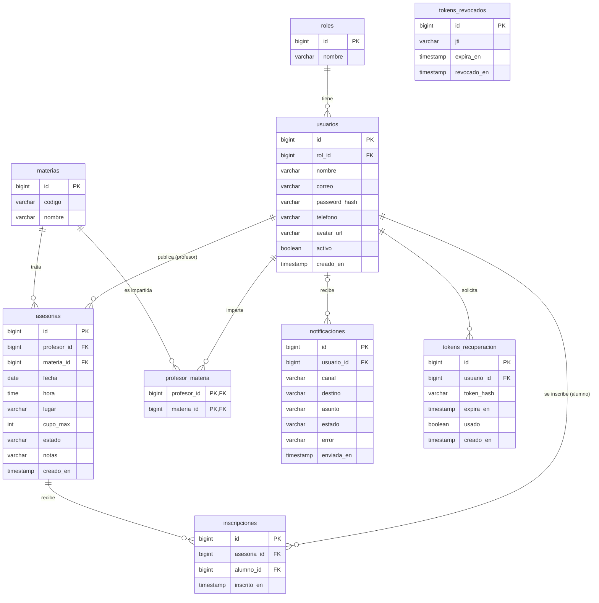
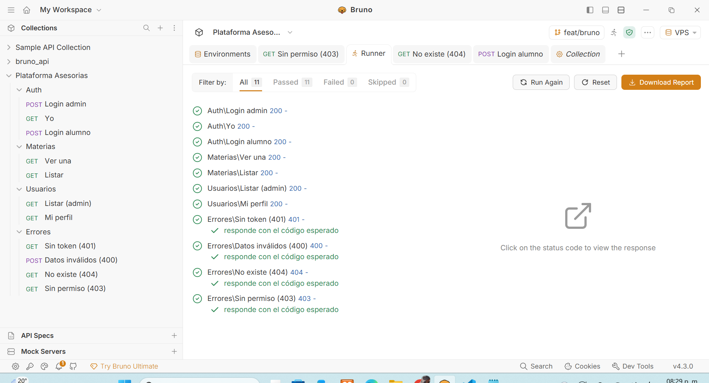

<div align="center">


# AyudITO · Plataforma de Asesorías Académicas

Reserva asesorías con profesores: horarios claros, cupos visibles y aviso de cada cambio.

[**Ver la aplicación**](https://ayudito.juarez.top) ·
[Prototipo en Figma](https://www.figma.com/proto/Ibm7b85izfPN6iETO4eqrj/Asesorias?node-id=25-248&p=f&viewport=-2705%2C205%2C0.18&t=OfgIv70zdHWFNawM-1&scaling=min-zoom&content-scaling=fixed&starting-point-node-id=25%3A248&page-id=20%3A111) ·
[Tablero del proyecto](https://github.com/users/Isaac051225/projects/2)

`Java 21` `Spring Boot 4.1` `React 19` `Vite 8` `PostgreSQL` `HTTPS`

</div>

Proyecto final de **Programación Web** (Semestre 7). Los alumnos encuentran y reservan asesorías, los profesores publican y administran sus horarios, y un administrador gestiona usuarios, materias y el registro de avisos.

## Contenido

- [Vista previa](#vista-previa)
- [Usuarios de prueba](#usuarios-de-prueba)
- [Funciones por rol](#funciones-por-rol)
- [Arquitectura](#arquitectura)
- [Tecnologías](#tecnologías)
- [Seguridad](#seguridad)
- [API](#api)
- [Base de datos](#base-de-datos)
- [Instalación local](#instalación-local)
- [Pruebas](#pruebas)
- [Despliegue](#despliegue)
- [Avisos y limitaciones](#avisos-y-limitaciones)
- [Diseño](#diseño)
- [Equipo](#equipo)

## Vista previa

| Inicio de sesión | Catálogo (alumno) |
|---|---|
|  |  |

| Inicio (profesor) | Mis asesorías (profesor) |
|---|---|
|  |  |

| Inicio (administrador) | Usuarios (administrador) |
|---|---|
|  |  |

## Usuarios de prueba

| Rol | Correo | Contraseña |
|---|---|---|
| Administrador | `admin@asesorias.com` | `Admin123!` |
| Profesor | `aracely.ramirez@asesorias.com` | `Profesor123!` |
| Alumno | `maria.hernandez@asesorias.com` | `Alumno123!` |

## Funciones por rol

| Rol | Puede |
|---|---|
| **Alumno** | Ver el catálogo y filtrar por materia · inscribirse si hay lugar · cancelar su inscripción · ver sus próximas asesorías |
| **Profesor** | Publicar asesorías de las materias que imparte · editar y cancelar las suyas · ver quién está inscrito |
| **Administrador** | Buscar y filtrar usuarios · crear profesores · editar, activar y desactivar cuentas · administrar materias · consultar el registro de avisos |

Todos pueden iniciar y cerrar sesión, recuperar su contraseña y editar su perfil. El registro público crea cuentas de alumno.

### Reglas de negocio

- Solo las asesorías activas admiten inscripciones.
- Un alumno no puede inscribirse dos veces en la misma asesoría. La base de datos también lo impide.
- El cupo se respeta aunque dos personas pidan el último lugar al mismo tiempo: la asesoría se bloquea mientras se procesa cada inscripción.
- Un profesor solo publica materias que imparte y solo modifica sus propias asesorías.
- Solo se editan asesorías activas, y el cupo no puede quedar por debajo de los inscritos.
- Una asesoría cancelada no se puede volver a cancelar.
- La fecha debe ser hoy o posterior, y el cupo va de 1 a 100.

## Arquitectura



1. **La página (React)** es lo que ve el usuario. Pide y envía datos a la API.
2. **La API (Spring Boot)** comprueba la sesión y los permisos, aplica las reglas de negocio y guarda los datos.
3. **La base de datos (PostgreSQL)** guarda usuarios, materias, asesorías, inscripciones, avisos y tokens.

### Estructura del repositorio

```text
plataforma-asesorias/
├── backend/        API en Spring Boot
│   └── src/main/java/com/asesorias/
│       ├── auth/  usuario/  materia/  asesoria/  inscripcion/
│       ├── notificacion/  correo/
│       └── config/  comun/  error/  seed/
├── frontend/       Aplicación web en React
├── database/       Respaldo, restauración y despliegue
├── bruno/          Colección de pruebas de la API
├── capturas/       Imágenes de este documento
└── docs/           Documentación de apoyo
```

## Tecnologías

| Parte | Herramientas |
|---|---|
| Backend | Java 21, Spring Boot 4.1 (Web MVC, Data JPA, Validation, Security, Mail), Lombok |
| Sesión | JWT con Spring Security OAuth2 Resource Server |
| Frontend | React 19, React Router, Axios, Vite 8 |
| Base de datos | PostgreSQL 16 o superior, migraciones con Flyway |
| Avisos | Correo (Postfix y Mailgun), SMS y WhatsApp (Twilio) |
| Pruebas | JUnit y Mockito, Bruno |
| Servidor | Linux, Nginx, Certbot, systemd |

## Seguridad

- **Contraseñas:** se guardan como hash **BCrypt**, nunca en texto plano. Piden mínimo 8 caracteres, con una mayúscula, un número y un carácter especial.
- **Sesión:** token **JWT** firmado con HS256, con vigencia configurable (120 minutos por defecto). El servidor no guarda sesiones.
- **Cierre de sesión:** el identificador del token se registra como revocado y deja de aceptarse.
- **Permisos:** cada operación restringida valida el rol en el servidor, no solo en la pantalla.
- **Recuperación de contraseña:** enlace de un solo uso que vence en 30 minutos. En la base solo se guarda el hash SHA-256 del token, y la respuesta es la misma exista o no el correo.
- **Cuentas desactivadas:** no pueden iniciar sesión.
- **CSRF:** está desactivado porque la sesión viaja en el encabezado `Authorization` y no en cookies.
- **Secretos:** `application.properties` no se sube al repositorio. La app no arranca si la clave del token mide menos de 32 bytes.
- **Validación en dos lados:** los formularios avisan antes de enviar y la API vuelve a revisar los datos.

## API

Base: `https://ayudito.juarez.top/api`. Salvo las rutas públicas, todas piden el encabezado `Authorization: Bearer <token>`.

En las tablas, **Sesión** significa cualquier usuario que haya iniciado sesión.

### Autenticación

| Método | Ruta | Acceso | Qué hace |
|---|---|---|---|
| POST | `/auth/registro` | Público | Crea una cuenta de alumno (201) |
| POST | `/auth/login` | Público | Inicia sesión y entrega el token |
| GET | `/auth/me` | Sesión | Usuario actual |
| POST | `/auth/logout` | Sesión | Revoca el token (204) |
| POST | `/auth/recuperar` | Público | Envía el enlace de recuperación (204) |
| POST | `/auth/restablecer` | Público | Cambia la contraseña con el enlace (204) |

### Asesorías e inscripciones

| Método | Ruta | Acceso | Qué hace |
|---|---|---|---|
| GET | `/asesorias` | Sesión | Catálogo, con filtros por materia y estado |
| GET | `/asesorias/{id}` | Sesión | Detalle |
| GET | `/asesorias/mias` | Profesor | Sus asesorías |
| POST | `/asesorias` | Profesor | Publica una asesoría |
| PUT | `/asesorias/{id}` | Profesor | Edita una propia |
| PATCH | `/asesorias/{id}/cancelar` | Profesor | Cancela una propia |
| POST | `/asesorias/{id}/inscripciones` | Alumno | Se inscribe |
| DELETE | `/asesorias/{id}/inscripciones` | Alumno | Cancela su inscripción |
| GET | `/asesorias/{id}/inscripciones` | Profesor | Inscritos de una propia |
| GET | `/inscripciones/mias` | Alumno | Sus inscripciones |

### Materias

| Método | Ruta | Acceso | Qué hace |
|---|---|---|---|
| GET | `/materias` | Sesión | Lista de materias |
| GET | `/materias/{id}` | Sesión | Detalle |
| POST | `/materias` | Administrador | Crea |
| PUT | `/materias/{id}` | Administrador | Edita |
| DELETE | `/materias/{id}` | Administrador | Elimina |
| GET | `/materias/profesores/{profesorId}` | Sesión | Materias de un profesor |
| PUT | `/materias/profesores/{profesorId}` | Administrador | Asigna materias a un profesor |

### Usuarios y notificaciones

| Método | Ruta | Acceso | Qué hace |
|---|---|---|---|
| GET | `/usuarios` | Administrador | Lista y búsqueda |
| POST | `/usuarios` | Administrador | Crea un profesor |
| GET | `/usuarios/me` | Sesión | Su perfil |
| PUT | `/usuarios/me` | Sesión | Edita su perfil |
| PUT | `/usuarios/{id}` | Administrador | Edita un usuario |
| PATCH | `/usuarios/{id}/activar` | Administrador | Activa la cuenta |
| PATCH | `/usuarios/{id}/desactivar` | Administrador | Desactiva la cuenta |
| GET | `/notificaciones` | Administrador | Registro de avisos |

### Formato de respuestas

- **Listas paginadas:** `content`, `page`, `size`, `totalElements` y `totalPages`. La paginación y los filtros los resuelve el servidor.
- **Errores:** todos usan los mismos campos: `fecha`, `estado`, `error`, `mensaje` y `ruta`. En errores de validación se agrega `errores`, con el detalle por campo.
- **Códigos:** `400` datos inválidos · `401` sin sesión · `403` sin permiso · `404` no existe · `422` regla de negocio.

## Base de datos



- `profesor_materia` es la relación muchos a muchos entre profesores y materias. `inscripciones` lo es entre alumnos y asesorías.
- `tokens_revocados` guarda los tokens cerrados al salir. No se relaciona con otra tabla.
- La migración V4 también crea `password_reset_tokens`, que quedó sin uso: la reemplazó `tokens_recuperacion` (V6).

El esquema se controla con las migraciones de Flyway, en `backend/src/main/resources/db/migration`.

### Respaldo y restauración

[`database/backup.sql`](database/backup.sql) contiene la estructura y los datos de ejemplo. Restáuralo en una base **vacía**.

En Linux, desde la carpeta `database` (usa el usuario `postgres`):

```bash
cd database
bash restaurar.sh asesorias_db
```

En Windows, desde la raíz del repositorio:

```powershell
createdb -U postgres asesorias_db
psql -U postgres -d asesorias_db -f database/backup.sql
```

## Instalación local

### Requisitos

- Java 21
- Node.js 20.19 o superior (en la serie 20), o 22.12 en adelante
- PostgreSQL 16 o superior
- Git

### 1. Clonar el proyecto

```bash
git clone https://github.com/DaniielA5/plataforma-asesorias.git
cd plataforma-asesorias
```

### 2. Crear la base de datos

En PostgreSQL:

```sql
CREATE DATABASE asesorias_db;
```

### 3. Configurar el backend

Copia el archivo de ejemplo.

Windows (PowerShell):

```powershell
Copy-Item backend/src/main/resources/application.properties.example backend/src/main/resources/application.properties
```

Linux o macOS:

```bash
cp backend/src/main/resources/application.properties.example backend/src/main/resources/application.properties
```

Llena estos valores:

| Propiedad | Qué poner |
|---|---|
| `spring.datasource.username` | Tu usuario de PostgreSQL |
| `spring.datasource.password` | Su contraseña |
| `app.jwt.secreto` | Una clave aleatoria en Base64, de 32 bytes o más |

Para generar la clave en PowerShell:

```powershell
$b = New-Object byte[] 32; [Security.Cryptography.RandomNumberGenerator]::Create().GetBytes($b); [Convert]::ToBase64String($b)
```

En Linux o macOS:

```bash
openssl rand -base64 32
```

Deja las líneas de **correo** como vienen, porque la app las necesita para arrancar. Sin un servidor de correo local, el envío falla y solo queda registrado. **Twilio** viene desactivado: los SMS y WhatsApp se simulan y se escriben en la consola.

### 4. Arrancar el backend

Windows:

```powershell
cd backend
.\mvnw.cmd spring-boot:run
```

Linux o macOS:

```bash
cd backend
./mvnw spring-boot:run
```

La primera vez, Flyway crea las tablas. Si no hay usuarios, se cargan los datos de ejemplo: 1 administrador, 4 profesores, 10 alumnos, 12 materias y 15 asesorías, con sus inscripciones.

### 5. Arrancar el frontend

En otra terminal, desde la raíz:

```bash
cd frontend
npm install
npm run dev
```

Abre <http://localhost:5173>. La página envía las peticiones `/api` a `http://localhost:8080`. Si tu backend usa otra dirección, define `VITE_BACKEND_URL`.

### Problemas comunes

| Síntoma | Solución |
|---|---|
| `app.jwt.secreto debe tener al menos 32 bytes` | Genera la clave como en el paso 3 |
| No conecta con la base de datos | Revisa que PostgreSQL esté encendido y que el nombre, usuario y contraseña coincidan |
| No aparecen los datos de ejemplo | Solo se cargan cuando la tabla de usuarios está vacía |
| Avisos por correo en `FALLIDA` en local | Es normal si no tienes servidor de correo |

## Pruebas

### Backend

Necesitan PostgreSQL encendido y `application.properties` configurado.

```powershell
cd backend
.\mvnw.cmd test
```

Son **35 pruebas**. Incluyen autenticación de extremo a extremo, reglas de asesorías, formato de errores, paginación, correo y registro de avisos.

### API con Bruno

La carpeta [`bruno/`](bruno) tiene una colección para [Bruno](https://www.usebruno.com/) con **11 peticiones**: inicio de sesión, materias, usuarios y los errores `400`, `401`, `403` y `404`.

Ábrela, elige el entorno **VPS** y pulsa **Run**. Para el entorno **Local**, revisa que `baseUrl` use el puerto de tu backend (8080 por defecto).



## Despliegue

La aplicación está publicada en un servidor Linux:

- **Nginx** sirve el frontend compilado y reenvía `/api` al backend.
- **HTTPS** con certificado de Let's Encrypt, con renovación automática mediante Certbot. HTTP redirige a HTTPS.
- El **backend** corre como servicio de systemd, con un usuario sin privilegios, y solo es accesible a través de Nginx.
- La base de datos de producción tiene su propio usuario y clave del token, distintos de los de desarrollo.

### Correo propio

La API entrega cada correo a **Postfix** en el mismo servidor. **OpenDKIM** lo firma y Postfix lo reenvía por **Mailgun** usando el puerto 2525, porque el proveedor del servidor bloquea los puertos 25, 465 y 587. El dominio de envío `mg.juarez.top` tiene **SPF, DKIM y DMARC**; en la prueba con Gmail los tres pasaron y el mensaje llegó a la bandeja de entrada.

### Actualizar el backend

Después de fusionar en `main`, en el servidor y desde la carpeta del proyecto:

```bash
bash database/desplegar.sh
```

El script descarga los cambios, compila, reinicia el servicio y comprueba que responda. Un `401` en `/api/auth/me` es lo esperado, porque la prueba va sin sesión.

### Actualizar el frontend

Se compila en la computadora de desarrollo, porque el servidor tiene poca memoria:

```bash
cd frontend
npm run build
scp -r dist/* <usuario>@<servidor>:/var/www/ayudito/
```

## Avisos y limitaciones

| Evento | SMS o WhatsApp | Correo |
|---|---|---|
| Alumno se registra | No | Bienvenida |
| Usuario pide recuperar su contraseña | No | Enlace de recuperación |
| Alumno se inscribe | WhatsApp | Inscripción confirmada |
| Alumno cancela su inscripción | WhatsApp | Cancelación de inscripción |
| Profesor cancela una asesoría | SMS a cada inscrito | Aviso a cada inscrito |

Los avisos de asesorías se registran con su canal, destino, estado y motivo del error. El administrador los consulta en **Administración → Notificaciones**. Si un envío falla, la operación del usuario se completa de todos modos. Los correos de bienvenida y recuperación no aparecen en ese registro.

**Limitaciones conocidas:**

- La cuenta de prueba de Twilio solo permite **SMS con plantillas predefinidas, en inglés**, y a números verificados. El texto propio requiere una cuenta de pago.
- Con la configuración actual, los envíos por **WhatsApp fallan** y quedan registrados como `FALLIDA`.
- Por eso el **correo** es el canal que entrega el aviso con texto propio en español.
- En un correo, `ENVIADA` significa que la API lo entregó al servidor de correo. No confirma que haya llegado a la bandeja.
- Los usuarios de ejemplo tienen correos y teléfonos ficticios, así que no sirven para probar la recepción de avisos.

## Diseño

El diseño se hizo en Figma antes de programar, con un [prototipo navegable](https://www.figma.com/proto/Ibm7b85izfPN6iETO4eqrj/Asesorias?node-id=25-248&p=f&viewport=-2705%2C205%2C0.18&t=OfgIv70zdHWFNawM-1&scaling=min-zoom&content-scaling=fixed&starting-point-node-id=25%3A248&page-id=20%3A111). El logo es propio: [`frontend/src/assets/logo.svg`](frontend/src/assets/logo.svg).

| Color | Código | Uso |
|---|---|---|
| Crema | `#F2EDE4` | Fondo de las pantallas (60 %) |
| Verde oscuro | `#263128` | Color principal: textos fuertes y navegación (30 %) |
| Terracota | `#BC6245` | Acento: botones principales y detalles (10 %) |

El verde transmite calma y confianza, algo útil en una plataforma para estudiar. La terracota contrasta con el verde, así que los botones importantes se ven de inmediato. El crema cansa menos la vista que el blanco puro. Seguimos la regla **60-30-10**.

**Tipografías:** Playfair Display y Work Sans.

## Equipo

| Integrante | Parte |
|---|---|
| Daniel Alexis Juarez Ramirez | Inicio de sesión y seguridad, asesorías e inscripciones, recuperar contraseña, correos y avisos por correo, rediseño de inicio y login, base de datos y respaldo, despliegue en el VPS |
| Isaac Emmanuel Díaz Martinez | Materias, usuarios y perfil (servidor), notificaciones y Twilio, datos de ejemplo, componentes y barra de navegación, formularios de acceso, pantallas de administración, colección de Bruno, README |
